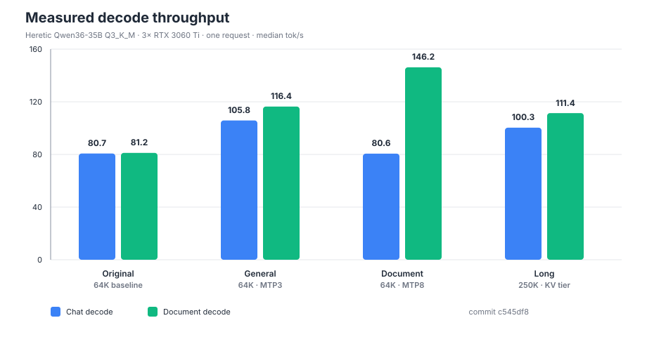
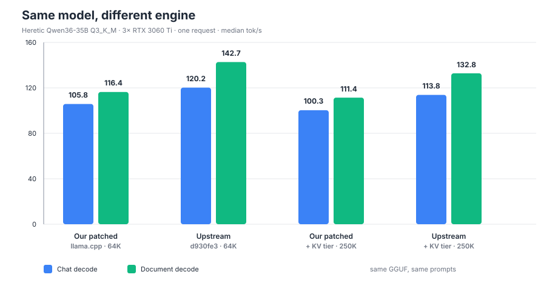

# dolanan-gpu

**Measured inference optimization for three consumer GPUs.** Built and benchmarked on 3× RTX 3060 Ti (8GB each) with 125GB host RAM. **Current deployment (2026-11-08):** `sage-a15` — Sage-A1.5 35B MoE (Heretic abliterated, IQ3_M) on the latest upstream llama.cpp — behind an API-key gateway. The Qwen3.8 MoE remains as rollback. The results below were measured earlier on `heretic-qwen36-35b` Q3_K_M and are kept as history.

No synthetic claims: every number below comes from the included benchmark harness on this machine.



## Current deployment (2026-11-08)

```
Cloudflare (llm.glicc.id)  ─┐
                             ├─→ gateway :8081 ─→ llama-server :8084
Tailscale (tailnet only)   ─┘     systemd            systemd
```

| Piece | Value |
|---|---|
| Model | `Sage-A1.5-Heretic-Abliterated-Uncensored.i1-IQ3_M.gguf` (15.44 GB) |
| Engine | **latest upstream `engines/llamacpp-latest`** (0.9.0-dev, f7591a6); the old mainline cannot load this quant, the competitor fork stalls on slot reuse |
| Cards | 3 × 8 GB, layer split, `-ts 1,1,0.9` |
| Context | `-c 262144`, `--parallel 1` → **one full 262,144 window** |
| Micro-batch | `-ub 512` |
| Cache | `-ctk/-ctv q4_0`, **prompt cache enabled**, no MTP (this quant has none) |
| Sampling | temp 0.6, top_p 0.95, top_k 20, min_p 0.05, penalties 0, **DRY 0.8/1.75/2/0**; thinking **off by default** |
| Gateway | key-gated, prompt cache **on** (the new engine has no slot-reuse stall), `max_queued: 3`, cancellation-safe release |
| Services | `llama-qwen38moe.service`, `glicc-gateway.service` (units in `gateway/`) |

Measured on this engine (2026-11-08): prefill **~4,748 tok/s** (30k in 6.2 s), decode
**45 tok/s**, cached turn **0.99 s**; a 194,737-token prompt prefilled at 2,848 tok/s and
retrieved its needle (TTFB 71 s). VRAM 7,703 / 7,265 / 6,467 MiB, zero slot warnings.
Vision is currently off (mmproj omitted for stability).

Operational notes:
- Public `https://llm.glicc.id/v1` has Cloudflare's **125 s proxy read timeout** (Error 524).
  The tailnet endpoint `https://dalang-z9pe-d8-ws.tailed0f24.ts.net/v1` has no such limit.
- Live config is one slot at 262,144. For two concurrent sessions instead, set `PARALLEL=2` with `CTX=327680` (163,840 each).

Files: `run-llama.sh` (launcher), `scripts/ub_ladder.sh` (micro-batch ladder),
`gateway/app.py` (queue/key gateway), `gateway/*.service` (units).

## Results

| Mode | Engine | Context | Chat tok/s | Document tok/s |
|---|---|---:|---:|---:|
| Original baseline | pinned llama.cpp | 64K | 80.7 | 81.2 |
| General — MTP3/Q4 | pinned llama.cpp | 64K | 105.8 | 116.4 |
| Document — MTP8/Q4 | pinned llama.cpp | 64K | 80.6 | 146.2 |
| Long — selective KV tier | pinned llama.cpp | 250K | 100.3 | 111.4 |
| **Upstream general — MTP3/Q4** | upstream `d930fe3` | 64K | **120.2** | **142.7** |
| **Upstream long — selective KV tier** | upstream `d930fe3` | **250K** | **113.8** | **132.8** |

Long mode provides four times the baseline context while remaining faster for chat. Both 250K modes passed a hidden-code retrieval test with **73,378 prompt tokens**.

## Challenger benchmark



Current upstream llama.cpp beat the pinned patched build at the same 64K context by roughly **14% chat / 23% document**. Applying our selective KV patch to upstream produced the best 250K configuration. Details, research matrix, exact revisions, and fairness notes are in [`COMPETITORS.md`](COMPETITORS.md).

## What was optimized

- Native MTP draft depth tuned per workload: 3 for general use, 8 for predictable documents.
- Q4 target and draft KV cache with FlashAttention.
- Background sampling beats CPU sampling on this box.
- Selective KV tier: selected full-attention KV layers live in host RAM while the rest stays in VRAM. This made 250K context possible without running a whole MoE layer on the CPU.
- Native C++ phase instrumentation measures draft, target verification, MTP catch-up, and acceptance cost.
- Measured correction: target verification is ~67% of generation time; MTP catch-up is only ~3.6%, so earlier catch-up optimization was not the right target.

See [`RESULTS.md`](RESULTS.md), [`CONTEXT.md`](CONTEXT.md), and [`PHASES.md`](PHASES.md).

## Quick start

```bash
git clone https://github.com/Kmassidik/dolanan-gpu.git
cd dolanan-gpu
export LLAMA_API_KEY='your-key'

./scripts/serve.sh chat           # pinned build, 64K general
./scripts/serve.sh document       # pinned build, 64K document-optimized
./scripts/serve.sh long           # pinned build, 250K selective KV tier
./scripts/serve.sh upstream-long  # upstream build + KV tier, fastest 250K
```

The launcher expects the llama.cpp builds and GGUF model described in [`CONTEXT.md`](CONTEXT.md) and [`COMPETITORS.md`](COMPETITORS.md). It replaces any running `llama-server`.

## Benchmark a running server

```bash
python3 -m gpu_optimized bench --url http://127.0.0.1:8081 --runs 3
```

Through SSH to a remote localhost-only server:

```bash
python3 -m gpu_optimized bench --ssh root@100.122.45.32 --runs 3
```

Compare two saved configurations:

```bash
python3 -m gpu_optimized compare results/before.json results/after.json
```

Validate real long-context retrieval:

```bash
python3 -m gpu_optimized.context_check --target-tokens 70000
```

## Reproduce configuration sweeps

A sweep starts each configuration in isolation, benchmarks it, records failures, and stops the server before the next variant. Variants can set extra environment variables with an `env` object.

```bash
python3 -m gpu_optimized.sweep --plan plans/kv-tier.json --replace-existing
```

API keys come from `LLAMA_API_KEY`; they are never written to result JSON. Generated samples and server logs are ignored by git.

## Repository layout

```text
assets/performance.svg      measured performance chart
assets/competitors.svg      engine challenger chart
gpu_optimized/              benchmark, sweep, comparison, long-context CLI
native/                     small native helpers shipped with patches
patches/                    llama.cpp patches and apply instructions
plans/                      reproducible sweep definitions
scripts/serve.sh            measured production launchers
RESULTS.md                  speculative and execution results
CONTEXT.md                  250K context and memory-tier results
PHASES.md                   native phase breakdown
COMPETITORS.md              alternative-engine research and benchmark
```

## Native patches

`0004-native-phase-timings.patch` adds per-request timing fields: `draft_ms`, `target_ms`, `catchup_ms`, `accept_ms`.

`0005-selective-kv-tier.patch` adds `LLAMA_KV_CPU_LAYERS=3,7,11` support for placing selected attention-layer KV caches in host RAM. It applies cleanly to both the pinned build and current upstream.

Earlier adaptive-MTP patches are retained as evaluation history but are not used in production. See [`patches/README.md`](patches/README.md).

## Method

- Chat workload: 128-token open-ended explanation.
- Document workload: 256-token reproduction of a repetitive document.
- Decode rate comes from llama.cpp `timings.predicted_per_second`.
- Runs are median-aggregated; raw samples remain available.
- Prompt caching may reduce prefill time on repeated runs, so decode throughput is the primary comparison metric.
- Long-context correctness is tested with a hidden code that must be retrieved from beyond 64K tokens.

## Forking and reuse

This project is MIT licensed. You may fork it, modify it, redistribute it, publish derivative engines, or use it commercially, provided the copyright and permission notice remain with substantial copies of the software. There is no warranty.

llama.cpp itself remains under its own upstream license. Patches in this repository apply to upstream code and do not change upstream licensing. See [`NOTICE.md`](NOTICE.md).

## License

MIT
