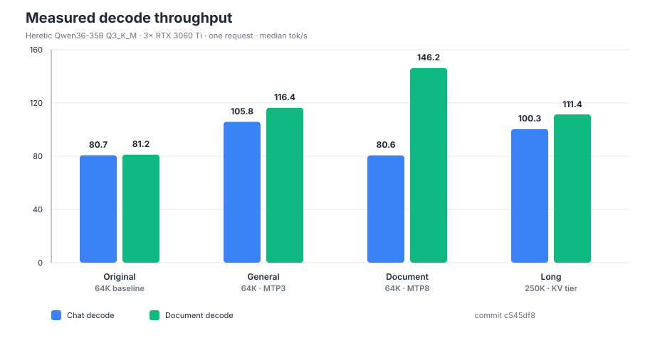

# dolanan-gpu

**Measured inference optimization for three consumer GPUs.** Built and benchmarked on 3× RTX 3060 Ti (8GB each) with 125GB host RAM, serving `heretic-qwen36-35b` Q3_K_M through a patched llama.cpp.

No synthetic claims: every number below comes from the included benchmark harness on this machine.



## Results

| Mode | Context | Chat tok/s | Document tok/s |
|---|---:|---:|---:|
| Original baseline | 64K | 80.7 | 81.2 |
| **General** — MTP3/Q4 | 64K | **105.8** | **116.4** |
| **Document** — MTP8/Q4 | 64K | 80.6 | **146.2** |
| **Long** — MTP3/Q4 + selective KV tier | **250K** | **100.3** | **111.4** |

Long mode provides four times the context of the baseline while remaining about 30% faster for chat. It passed a hidden-code retrieval test with **73,378 prompt tokens**.

## What was optimized

- Native MTP draft depth tuned per workload: 3 for general use, 8 for predictable documents.
- Q4 target and draft KV cache with FlashAttention.
- Background sampling beats CPU sampling on this box.
- Selective KV tier: attention-layer KV `3,7,11` resides in host RAM while the rest stays in VRAM. This made 250K context possible without running a whole MoE layer on the CPU.
- Native C++ phase instrumentation measures draft, target verification, MTP catch-up, and acceptance cost.
- Measured correction: target verification is ~67% of generation time; MTP catch-up is only ~3.6%, so earlier catch-up optimization was not the right target.

See [`RESULTS.md`](RESULTS.md), [`CONTEXT.md`](CONTEXT.md), and [`PHASES.md`](PHASES.md).

## Quick start

```bash
git clone https://github.com/Kmassidik/dolanan-gpu.git
cd dolanan-gpu
export LLAMA_API_KEY='your-key'

./scripts/serve.sh chat      # 64K general
./scripts/serve.sh document  # 64K document-optimized
./scripts/serve.sh long      # 250K selective KV tier
```

The launcher expects the llama.cpp build and GGUF model described in [`CONTEXT.md`](CONTEXT.md). It replaces any running `llama-server`.

## Benchmark a running server

```bash
python3 -m gpu_optimized bench --url http://127.0.0.1:8081 --runs 3
```

Through SSH to a remote localhost-only server:

```bash
python3 -m gpu_optimized bench --ssh root@100.122.45.32 --runs 3
```

Compare two saved configurations:

```bash
python3 -m gpu_optimized compare results/before.json results/after.json
```

Validate real long-context retrieval:

```bash
python3 -m gpu_optimized.context_check --target-tokens 70000
```

## Reproduce configuration sweeps

A sweep starts each configuration in isolation, benchmarks it, records failures, and stops the server before the next variant. Variants can set extra environment variables with an `env` object.

```bash
python3 -m gpu_optimized.sweep --plan plans/kv-tier.json --replace-existing
```

API keys come from `LLAMA_API_KEY`; they are never written to result JSON. Generated samples and server logs are ignored by git.

## Repository layout

```text
assets/performance.svg      measured performance chart
gpu_optimized/              benchmark, sweep, comparison, long-context CLI
native/                     small native helpers shipped with patches
patches/                    llama.cpp patches and apply instructions
plans/                      reproducible sweep definitions
scripts/serve.sh            measured production launchers
RESULTS.md                  speculative and execution results
CONTEXT.md                  250K context and memory-tier results
PHASES.md                   native phase breakdown
```

## Native patches

`0004-native-phase-timings.patch` adds per-request timing fields: `draft_ms`, `target_ms`, `catchup_ms`, `accept_ms`.

`0005-selective-kv-tier.patch` adds `LLAMA_KV_CPU_LAYERS=3,7,11` support for placing selected attention-layer KV caches in host RAM.

Earlier adaptive-MTP patches are retained as evaluation history but are not used in production. See [`patches/README.md`](patches/README.md).

## Method

- Chat workload: 128-token open-ended explanation.
- Document workload: 256-token reproduction of a repetitive document.
- Decode rate comes from llama.cpp `timings.predicted_per_second`.
- Runs are median-aggregated; raw samples remain available.
- Prompt caching may reduce prefill time on repeated runs, so decode throughput is the primary comparison metric.
- Long-context correctness is tested with a hidden code that must be retrieved from beyond 64K tokens.

## License

MIT
